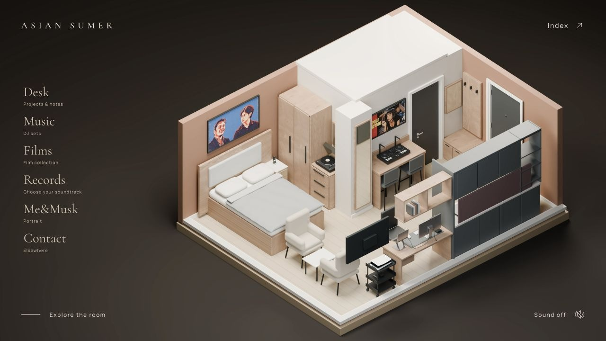
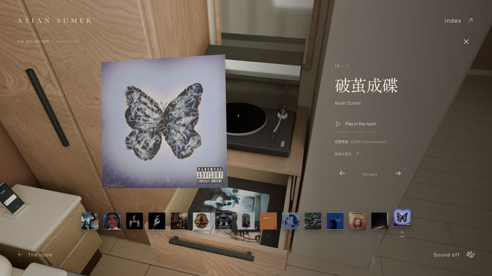
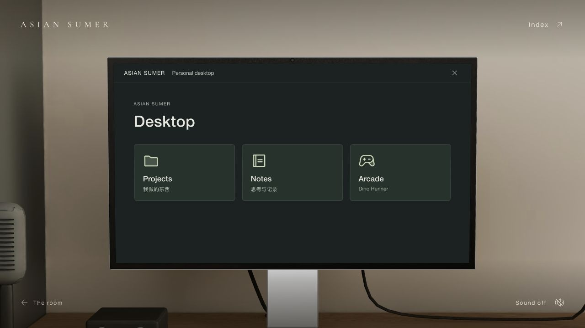

# Asian Sumer — The Room

以我的公寓为原型，把音乐、独立项目和个人收藏放进同一个空间的个人网站。

**[进入房间 ↗](https://asiansumer.com/)** · [30 秒演示](assets/room-tour.mp4) · [技术说明](docs/engineering.md) · [English](README.md)

## 为什么是一间房？

之前的个人网站更像一份简历。我想呈现得完整一些：我做和听的音乐、正在推进的项目，以及反复回看的电影和书。

公寓让这些内容都有了具体的位置。抽屉里是唱片，电脑里是项目和小游戏，电视里是电影收藏。访客选择一个角落，通过事先设计的镜头在房间里移动。

## 房间里的内容

| 角落 | 交互 |
| --- | --- |
| **Records** | 翻看叠放的专辑封套，选一张唱片，让它成为浏览网站时的背景音乐。 |
| **Music** | 播放我录制的 DJ Set，通过波形定位；切到其他场景后仍可继续听。 |
| **Desk** | 打开 Studio Display，查看项目，或玩带共享排行榜的恐龙小游戏。 |
| **Films** | 在电视上滚动浏览电影收藏，点击海报进入对应的豆瓣页面。 |
| **Contact** | 通过床头充电座上的手机打开联系方式和 Portfolio。 |
| **Archive** | 探索放着正在读的书、未完成 Demo 和进行中内容的隐藏空间。 |

[无声演示](assets/room-tour.mp4)取自实际运行的网站。总览是公寓模型的渲染图；进入后的房间与镜头过渡是实时 3D。

## 三个技术取舍

**让屏幕真正能用。** 将显示器四个角投影到浏览器坐标，用一个 CSS 投影变换把 HTML 界面贴合到三维屏幕上，保留表单、链接和游戏的可操作性。

**让音乐贯穿一次访问。** 音频播放的生命周期独立于场景面板。用户明确切换音源时，先准备新音频，再把旧音源淡出并暂停，最后播放新音源；请求版本避免过时的加载结果抢回播放权。

**按解码后的资源体积做预算。** 手机 Safari 的崩溃反馈促使项目加入独立的移动端资源路径。主房间贴图的 RGBA 加 mipmap 估算从 **1,116 MiB 降至 134 MiB**，约减少 **88%**，保留几何结构与桌面端资源。这个数字来自资源尺寸计算，不是 Safari 进程内存实测；实机问题仍待复测确认。

[查看实现思路与取舍 →](docs/engineering.md)

## 技术栈

**React · Three.js · Blender · Vite · Cloudflare Workers · D1 · R2**

Blender 提供房间模型和烘焙光照；React 与 Three.js 负责镜头、物件交互及 HTML 屏幕；Cloudflare 托管网站、共享游戏记录、可编辑内容和媒体。

## 我的角色与制作方式

我确定公寓的创意方向，提供房间参考和个人内容，主导视觉与交互取舍，并通过多轮实际使用提出修改。项目采用 AI 辅助开发：Codex 参与代码实现、Blender 脚本建模、调试、测试和部署。展示材料会区分我主导的产品决策、使用的实现工具以及第三方组件。

## 当前状态与展示范围

网站已上线并持续迭代。**2026 年 10 月 15 日**最近一轮验证记录包括项目及部署适配器的 **116 项自动化检查通过**，以及浏览器检查。具体范围和限制见[验证说明](docs/validation.md)。

**这个仓库只提供项目介绍与演示，应用源码和原始资产保持私有。** 它是作品展示仓库，不是可直接运行的源码发布。参见[来源与素材说明](docs/credits.md)。

---

[网站](https://asiansumer.com/) · [Portfolio](https://asiansumer.com/portfolio/) · [GitHub](https://github.com/asiansumer)
