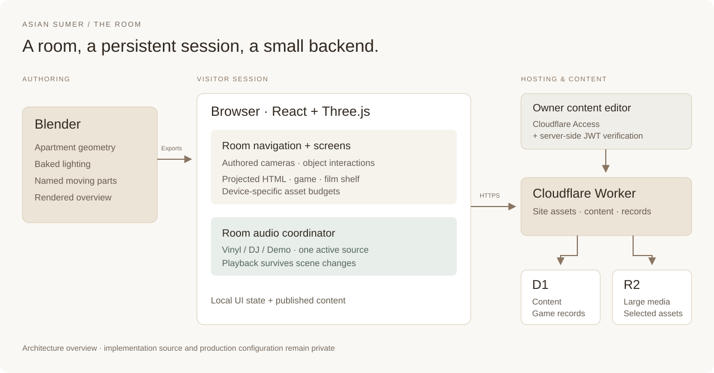

# Engineering notes

[Back to the project](../README.md)

These notes describe the implemented system and its trade-offs. The application source is private; diagrams explain responsibilities rather than exposing deployment configuration.

## System at a glance

| Layer | Responsibility |
| --- | --- |
| Blender | Apartment geometry, baked lighting, named interaction pivots and a rendered overview. |
| React + Three.js | Fixed camera destinations, object interactions, projected HTML screens and room navigation. |
| Room audio | Persistent vinyl, DJ and demo transports with exclusive source handoffs. |
| Cloudflare Worker | Application delivery and APIs for published content and game records. |
| D1 / R2 | Structured content and scores / larger media and selected model assets. |
| Owner editor | Draft and published content, with Cloudflare Access and server-side JWT verification. |

## 1. HTML that stays on a 3D screen

**Problem.** A monitor can look convincing while its clickable area is misaligned. Separately transforming nested DOM layers made hit targets difficult to reason about.

**Approach.** Define the physical screen's four corners in world space, project them through the active camera, and solve one projective mapping from the HTML rectangle to that quadrilateral. The same surface that displays the content receives input. The surface is shown at its intended interaction stop and hidden during ordinary room viewing.

The game fills the monitor by default. Its explicit expand button opens a native dialog in the browser's top layer. Expansion changes presentation without replacing the game iframe. Collapse returns to the same embedded surface.

**Trade-off.** Authored camera stops make composition and hit-target testing manageable. This is not a free-roaming first-person game. Responsive checks and real pointer interaction still matter; an element's presence in a DOM snapshot alone does not establish that its projected hit area works.

**Validation.** Browser checks cover opening the desktop and the game, entering the browser-wide dialog deliberately, and collapsing back to the monitor. The latest pass confirms the nickname gate is still present and no automatic full-screen expansion occurs.

## 2. One soundtrack, several physical sources

**Problem.** Vinyl, DJ sets and demos have separate interfaces and asynchronous loading. If each panel owns playback, changing scenes can stop music; if delayed requests complete out of order, two sources can sound at once.

**Approach.** A room-level coordinator owns the audio handoff. Navigation leaves transport state alone. An explicit playback request gets a new intent version:

1. Prepare the requested media silently.
2. Check that the request is still current.
3. Fade the other sources fully out and pause them.
4. Check the intent again, then start the requested source.

A newer selection or explicit pause invalidates older pending work. Leaving the DJ or record view does not resume a previously paused source. Record browsing and audio playback are separate actions.

**Trade-off.** There is a deliberate fade-to-silence handoff rather than overlapping playback. Preparing first means a failed incoming file can leave the current soundtrack intact. Native media elements stream the long DJ recordings; the entire set is not decoded into a Web Audio buffer in advance.

**Validation.** Automated cases exercise late media promises, rapid source changes, failed incoming media, preserved playheads and cancelled record placement. The showcase tour is silent and does not claim to demonstrate audio quality.

## 3. Mobile assets need a decoded-memory budget

**Problem.** An iPhone Safari report described the room appearing, flashing and then failing repeatedly. Compressed download size did not describe the cost of decoded textures. The main-room image set contained large baked maps and screen artwork.

**Approach.** Generate separate mobile GLBs with bounded embedded image dimensions before browser decoding. Preserve non-image geometry buffers, material definitions, nodes and articulated pivots. Keep desktop assets unchanged. Choose a device profile once per visit so rotation cannot unexpectedly select desktop resources.

| Main room image estimate | Before | Mobile derivative |
| --- | ---: | ---: |
| RGBA + mipmaps | 1,116.3 MiB | 134.0 MiB |

The estimate sums `width × height × 4 bytes × 4/3` per embedded image, approximating a full mip chain. It excludes geometry, render targets, browser memory and other scene assets. Driver allocation and actual texture formats may differ. The reduction is approximately 88%; it is not a measured frame-rate or process-memory improvement.

The mobile path also defers WebGL until a visitor selects a scene, limits pixel ratio and framebuffer size, reduces generated screen textures, and ignores resize notifications that do not change dimensions. A lost context has an explicit retry path rather than an automatic reload loop.

**Validation.** Regression checks compare geometry bytes and structural metadata, inspect actual derivative image dimensions and enforce a texture budget. Responsive browser checks cover initial overview, scene entry and orientation changes. Deployed mobile model hashes were checked against their local derivatives. **The original iPhone crash still needs physical-device confirmation.**

## Supporting decisions

- **Persisted game records:** a nickname and server-issued run ticket precede a run; game over triggers saving. Failed submissions retain their ticket for retry. Client scores have ownership, timing and input checks, not authoritative anti-cheat simulation.
- **Updateable collections:** the owner can update projects, films, books and demos through a content editor. A routine application build does not reimport or overwrite the production database.
- **Separate authoring and runtime assets:** editable Blender files remain separate from browser exports. The rendered overview is identified as such; real-time interiors are not presented as offline render captures.

See [validation](validation.md) for the dated evidence and [credits](credits.md) for component provenance.
